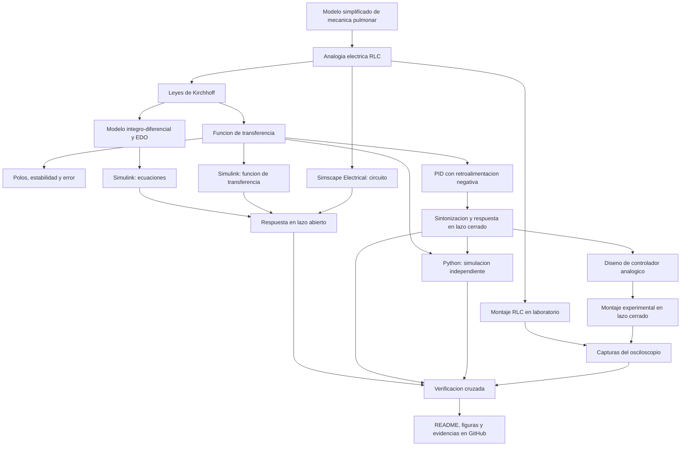

[](https://matlab.mathworks.com/open/github/v1?repo=Alexa-Montano/MSFP2)

# Práctica 2 --- Modelado y control del sistema cardiovascular mediante el modelo Windkessel

Repositorio académico de la asignatura **Modelado de Sistemas
Fisiológicos**, correspondiente al programa de **Ingeniería Biomédica**
del Tecnológico Nacional de México / Instituto Tecnológico de Tijuana.
Esta práctica integra modelado matemático, analogías eléctricas de
sistemas fisiológicos, análisis temporal y de estabilidad, diseño de
controladores PID y simulación computacional.

El caso de estudio representa la dinámica del sistema arterial mediante
el **modelo Windkessel de cuatro elementos**. Se comparan tres conjuntos
de parámetros que representan las condiciones hipotensa, normotensa e
hipertensa. La respuesta normotensa se utiliza como referencia, mientras
que los modelos hipotenso e hipertenso se analizan y controlan de manera
independiente para reducir sus diferencias respecto a dicha referencia.

**Docente:** Dr. Paul Antonio Valle Trujillo\
**Correo:** paul.valle@tectijuana.edu.mx\
**Departamento:** Ingeniería Eléctrica y Electrónica\
**Institución:** Tecnológico Nacional de México / Instituto Tecnológico
de Tijuana\
**Asignatura:** Modelado de Sistemas Fisiológicos\
**Programa:** Ingeniería Biomédica\
**Estudiante:** Alexa Montaño Gomez · 23212215 ·
L23212215@tijuana.tecnm.mx

**Repositorio de la asignatura:**
https://github.com/DrPaulValle/MSF-IBF1020\
**Sede:** Blvd. Alberto Limón Padilla s/n, Tijuana, C. P. 22454, B. C.,
México.

------------------------------------------------------------------------

## Contenido

1. [Resumen](#resumen)
2. [Competencia y objetivos](#objetivos)
3. [Relación con el temario](#temario)
4. [Modelo físico y analogía eléctrica](#analogia)

------------------------------------------------------------------------

`<a id="resumen">`{=html}`</a>`{=html} \## Resumen

La práctica tiene como propósito reproducir y verificar un modelo
cardiovascular mediante la formulación matemática, el análisis de su
comportamiento dinámico y la implementación de estrategias de control.
El sistema arterial se aproxima mediante el modelo Windkessel de cuatro
elementos: impedancia característica (Z), distensibilidad arterial (C),
resistencia periférica (R) e inertancia arterial (L).

Se consideran tres conjuntos de parámetros: hipotenso, normotenso e
hipertenso. Las diferencias entre los modelos se representan modificando
únicamente la distensibilidad arterial (C); los parámetros (Z), (R) y
(L) se mantienen constantes. El modelo normotenso se utiliza como
referencia y se comparan las respuestas de presión arterial asociadas
con los casos hipotenso e hipertenso.

La práctica incluye la obtención de las ecuaciones de estado y las
funciones de transferencia, el análisis del error en estado estacionario
y de la estabilidad, la simulación en MATLAB/Simulink y Simscape
Electrical, y la verificación independiente mediante Python. Finalmente,
se implementan dos sistemas de control con PID, uno para cada caso, y se
comparan sus respuestas con la referencia normotensa.

La práctica se desarrolla exclusivamente mediante experimentación **in
silico**. Los modelos y controladores tienen fines académicos y de
simulación; no representan una estrategia terapéutica ni una
recomendación clínica para tratar alteraciones de la presión arterial.

**Palabras clave:** modelo Windkessel; sistema cardiovascular; presión
arterial; distensibilidad arterial; impedancia característica;
inertancia; controlador PID; MATLAB; Simulink; Simscape Electrical;
Python.

------------------------------------------------------------------------

`<a id="objetivos">`{=html}`</a>`{=html} \## Competencia y objetivos

### Competencia a desarrollar

Modelizar sistemas fisiológicos mediante circuitos eléctricos
equivalentes, ecuaciones diferenciales y funciones de transferencia para
analizar su comportamiento dinámico y diseñar estrategias de control
mediante técnicas de control clásico. En esta práctica se analiza el
modelo Windkessel de cuatro elementos y se compara la respuesta
normotensa con dos casos simulados: hipotenso e hipertenso.

### Objetivo general

Modelar, simular y analizar el sistema cardiovascular mediante el modelo
Windkessel de cuatro elementos, comparando las condiciones hipotensa,
normotensa e hipertensa y diseñando controladores PID para reducir las
diferencias entre las respuestas de los casos y la respuesta normotensa
de referencia.

### Objetivos específicos

-   Identificar las variables, los parámetros y los elementos del modelo
    Windkessel de cuatro elementos.
-   Relacionar los elementos eléctricos equivalentes con las propiedades
    hemodinámicas del sistema arterial.
-   Formular el modelo mediante ecuaciones diferenciales ordinarias y
    obtener su representación en espacio de estados.
-   Obtener las funciones de transferencia de los modelos hipotenso,
    normotenso e hipertenso.
-   Calcular el error en estado estacionario y analizar la estabilidad
    de los tres modelos mediante sus polos.
-   Implementar los modelos mediante ecuaciones de estado, funciones de
    transferencia y Simscape Electrical.
-   Comparar las respuestas de presión arterial ante una misma señal
    aleatoria de entrada.
-   Diseñar dos sistemas de control independientes con retroalimentación
    y controladores PID.
-   Sintonizar los controladores y analizar su efecto sobre el
    seguimiento de la respuesta normotensa.
-   Reproducir los resultados mediante MATLAB/Simulink y Python.
-   Elaborar un diagrama biológico que relacione los elementos del
    modelo con las estructuras y propiedades cardiovasculares.
-   Documentar las simulaciones, las ganancias PID, las figuras y las
    conclusiones en un repositorio de GitHub.

------------------------------------------------------------------------

`<a id="temario">`{=html}`</a>`{=html} \## Relación con el temario

La práctica integra contenidos de la asignatura **Modelado de Sistemas
Fisiológicos (IBF-1020)**:

  -----------------------------------------------------------------------
  Área                                Contenidos aplicados
  ----------------------------------- -----------------------------------
  Sistemas de control                 Diagramas de bloques, comparación
  retroalimentados                    con una referencia, señal de error
                                      y control PID

  Modelado matemático                 Analogía circuito--sistema
                                      cardiovascular, ecuaciones
                                      diferenciales, espacio de estados y
                                      funciones de transferencia

  Análisis de sistemas                Respuesta temporal, error en estado
                                      estacionario, polos y estabilidad

  Simulación computacional            MATLAB, Simulink, Simscape
                                      Electrical y Python

  Fisiología cardiovascular           Presión arterial, flujo sanguíneo,
                                      distensibilidad, resistencia
                                      periférica e inertancia
  -----------------------------------------------------------------------

El enfoque combina ingeniería de control, electrónica, computación y
fisiología cardiovascular.

------------------------------------------------------------------------


## Descripción detallada del sistema

El sistema estudiado corresponde al sistema cardiovascular, específicamente al comportamiento hemodinámico de la circulación arterial. Para representar su dinámica se utiliza el modelo Windkessel de cuatro elementos, el cual permite describir la relación entre la presión y el flujo sanguíneo mediante parámetros que representan las propiedades físicas de los vasos sanguíneos y la sangre.

El modelo está compuesto por cuatro elementos: la impedancia característica (Z), que representa la oposición inicial al flujo sanguíneo; la distensibilidad arterial (C), relacionada con la capacidad de las arterias para expandirse ante los cambios de presión; la resistencia periférica (R), que representa la oposición al flujo sanguíneo en los vasos periféricos; y la inertancia sanguínea (L), asociada con la oposición a los cambios en el flujo debido a la inercia de la sangre.

A partir de estos elementos, se estudian tres condiciones cardiovasculares: hipotensa, normotensa e hipertensa. Para ello, se utilizan diferentes valores de los parámetros del modelo y se comparan sus respuestas mediante simulaciones computacionales. La implementación se realiza utilizando MATLAB, Simulink, Simscape Electrical y Python, con el propósito de analizar el comportamiento dinámico del sistema y verificar la consistencia de los resultados obtenidos mediante distintas representaciones.

**Palabras clave:** sistema cardiovascular, modelo Windkessel, presión arterial, flujo sanguíneo, hemodinámica, distensibilidad arterial, resistencia periférica, inertancia sanguínea, modelado de sistemas fisiológicos y simulación computacional.


`<a id="analogia">`{=html}`</a>`{=html} \## Modelo físico y analogía
eléctrica

El modelo Windkessel de cuatro elementos representa propiedades
relevantes de la dinámica arterial mediante cuatro elementos
equivalentes: una impedancia característica (Z), una distensibilidad
(C), una resistencia periférica (R) y una inertancia (L).

  ------------------------------------------------------------------------
  Símbolo                 Elemento eléctrico       Interpretación
                                                   fisiológica
  ----------------------- ------------------------ -----------------------
  (P_a(t))                Voltaje de entrada       Presión arterial de
                                                   entrada

  (P_p(t))                Voltaje en el nodo de    Presión asociada con la
                          salida                   distensibilidad
                                                   arterial

  (F_a(t))                Corriente de entrada     Flujo dirigido hacia la
                                                   aorta o arteria
                                                   representada

  (F_L(t))                Corriente por la         Flujo a través de la
                          inertancia               inertancia arterial

  \(Z\)                   Impedancia/resistencia   Impedancia
                          característica           característica de la
                                                   región proximal del
                                                   sistema arterial

  \(C\)                   Capacitancia             Distensibilidad
                                                   arterial total

  \(R\)                   Resistencia              Resistencia periférica

  \(L\)                   Inductancia              Inertancia asociada con
                                                   la masa de sangre en
                                                   movimiento
  ------------------------------------------------------------------------

La analogía se establece mediante la correspondencia entre presión y
voltaje, y entre flujo sanguíneo y corriente. La capacitancia representa
la capacidad arterial de almacenar volumen mediante distensión; la
resistencia representa la oposición al flujo y la inductancia representa
los efectos inerciales de la sangre en movimiento.

### Parámetros de los tres modelos

  Parámetro     Hipotenso   Normotenso   Hipertenso Unidades
  ----------- ----------- ------------ ------------ ---------------------------------
  \(Z\)             0.010        0.010        0.010 (`\mathrm{mmHg\,s/ml}`{=tex})
  \(L\)             0.001        0.001        0.001 (`\mathrm{mmHg\,s^2/ml}`{=tex})
  \(R\)             1.000        1.000        1.000 (`\mathrm{mmHg\,s/ml}`{=tex})
  \(C\)             3.500        1.500        1.000 (`\mathrm{ml/mmHg}`{=tex})

Las diferencias entre los tres conjuntos de parámetros se establecen
modificando únicamente (C). El caso hipotenso utiliza una
distensibilidad mayor, el normotenso una distensibilidad intermedia y el
hipertenso una distensibilidad menor. En esta práctica, el modelo
normotenso se considera la referencia para diseñar los sistemas de
control.

------------------------------------------------------------------------


**Diagrama del sistema físico y el controlador:** [`Multisim_Cerrado2.png`](Multisim_Cerrado2.png). La figura del instructivo fue elaborada originalmente con Multisim; las simulaciones actuales de componentes eléctricos se plantean en **Simscape Electrical**.

Los enlaces anteriores utilizan los **nombres de archivos citados por el documento de la práctica**. Funcionarán cuando esos archivos estén incluidos en la raíz del repositorio; si se organizan por carpetas, deberán ajustarse las rutas relativas del README. Los PDF se enlazan para su consulta, dado que GitHub no los presenta como imágenes incrustadas convencionales.

### Aspectos para discutir

- Coincidencia entre las representaciones por ecuaciones, función de transferencia y circuito físico simulado.
- Diferencias entre lazo abierto y lazo cerrado y efecto del PID sobre el seguimiento.
- Cumplimiento de $t_s\le100\,\mathrm{ms}$ y $M_p\le10\%$.
- Consistencia entre las figuras de MATLAB y Python.
- Diferencias entre resultados computacionales y señales medidas en el osciloscopio.
- Fuentes de incertidumbre y limitaciones de la analogía fisiológica.

**Resultados del estudiante:** agregar en la versión final del repositorio las ganancias sintonizadas, la evidencia de cumplimiento, las capturas y un comentario interpretativo propio sobre cada familia de respuestas. No se incluyen valores experimentales ni ganancias PID ficticias en esta plantilla.

[Volver al contenido](#contenido)

---

<a id="flujo"></a>
## Flujo de trabajo



El procedimiento integra la formulación analítica, la experimentación *in silico* y la comprobación con instrumentos de laboratorio.

[Volver al contenido](#contenido)

---

<a id="actividades"></a>
## Actividades del estudiante

La práctica sigue una secuencia de **reproducción, verificación y documentación**, no un proceso de identificación de parámetros a partir de datos experimentales.

### Etapa 1. Formulación y análisis

- [ ] Identificar en el circuito $P_{ao}(t)$, $P_A(t)$, $Q(t)$, $R$, $L$ y $C$.
- [ ] Derivar las ecuaciones integro-diferenciales.
- [ ] Comprobar la función de transferencia.
- [ ] Expresar el modelo como sistema de EDO lineales de primer orden.
- [ ] Calcular el error en estado estacionario ante escalón unitario.
- [ ] Calcular y representar los polos de la planta.
- [ ] Elaborar el bosquejo previo de respuesta al escalón.

### Etapa 2. Simulación de la planta

- [ ] Reproducir el modelo por ecuaciones en Simulink.
- [ ] Reproducir la función de transferencia en Simulink.
- [ ] Reproducir el circuito equivalente en Simscape Electrical.
- [ ] Comparar las respuestas a escalón, pulso, rampa y senoide.

### Etapa 3. Diseño y comprobación del controlador

- [ ] Implementar la retroalimentación negativa con PID.
- [ ] Sintonizar y registrar $k_P$, $k_I$ y $k_D$.
- [ ] Verificar el tiempo de establecimiento y el sobreimpulso.
- [ ] Reproducir las respuestas desde MATLAB y guardarlas en PDF.
- [ ] Reproducir las respuestas en Python con las mismas ganancias.
- [ ] Verificar las relaciones algebraicas del controlador analógico.
- [ ] Seleccionar componentes comerciales y comparar el controlador físico simulado con el ideal.

### Etapa 4. Comprobación experimental y documentación

- [ ] Construir y medir el circuito RLC en lazo abierto.
- [ ] Construir el circuito controlado en lazo cerrado.
- [ ] Registrar las cuatro entradas y sus respectivas respuestas.
- [ ] Comparar resultados de MATLAB, Python y laboratorio.
- [ ] Incorporar figuras, capturas y fotografías del montaje.
- [ ] Redactar una interpretación de los resultados y sus diferencias.
- [ ] Publicar los archivos y un `CITATION.cff` correctamente identificados.

[Volver al contenido](#contenido)

---

<a id="estructura"></a>
## Estructura del repositorio

Una organización **sugerida** para la entrega, compatible con los tipos de archivos solicitados, es:

```text
.
├── README.md                      # Reporte y guía de reproducción
├── CITATION.cff                   # Datos de citación del repositorio
├── Apellido_NoControl.mlx         # Cuaderno MATLAB del estudiante
├── Apellido_NoControl.pdf         # Exportación del cuaderno
├── modelo_respiratorio.slx        # Modelo Simulink/Simscape
├── modelo_respiratorio.py         # Implementación Python
├── pulmonar.pdf                  # Diagrama base del circuito (instructivo)
├── Multisim_Cerrado2.png         # Diagrama de referencia del controlador
├── controlador_pid.png           # Captura de sintonización (nombre sugerido)
├── step_matlab.pdf
├── impulse_matlab.pdf
├── ramp_matlab.pdf
├── sinusoidal_matlab.pdf
├── step_python.pdf
├── impulse_python.pdf
├── ramp_python.pdf
├── sinusoidal_python.pdf
├── stepLC.pdf
├── impulseLC.pdf
├── rampLC.pdf
├── sinLC.pdf
└── evidencias/                   # Fotografías y capturas adicionales
```

**Criterio de nombres:** los archivos de resultados y diagramas conservan las denominaciones citadas en el instructivo LaTeX. Los nombres de cuaderno, modelo, script y captura del PID son **propuestas organizativas**, ya que sus nombres reales no aparecen especificados en los archivos aportados. Si se utilizan otros nombres o subcarpetas, actualizar las rutas del README y no eliminar evidencias requeridas.

[Volver al contenido](#contenido)

---

<a id="requisitos"></a>
## Requisitos

### Software

- **MATLAB** y **Simulink**, con el modelo y el cuaderno de referencia.
- **Simscape Electrical**, para construir el circuito de componentes eléctricos.
- Herramientas de Simulink para diseño y sintonización del bloque **PID Controller**.
- **Python** y **Visual Studio Code** para ejecutar el programa suministrado.
- Las bibliotecas Python que importe efectivamente el código de referencia.
- **Git y GitHub** para organizar y presentar el repositorio de la práctica.

Para el ejemplo opcional de MATLAB de esta guía que utiliza `tf` y `pole`, es necesario disponer de las funciones correspondientes de **Control System Toolbox**. Las versiones mínimas del software no se especifican en el instructivo.

### Recursos de laboratorio

Circuito RLC y componentes del PID, amplificadores operacionales, protoboard, alimentación simétrica, generador de funciones, osciloscopio, multímetro, cables y medio de almacenamiento para las capturas.

[Volver al contenido](#contenido)

---

<a id="reproducibilidad"></a>
## Reproducibilidad y entregables

### Secuencia de reproducción

1. Consultar el [repositorio general de la asignatura](https://github.com/DrPaulValle/MSF-IBF1020) y descargar los archivos proporcionados para la práctica.
2. Verificar la topología del circuito, los valores de $R$, $L$, $C$ y las condiciones iniciales.
3. Derivar el modelo y completar el análisis de polos y error en estado estacionario.
4. Ejecutar los modelos de Simulink y Simscape con las cuatro entradas definidas.
5. Sintonizar el PID y registrar las ganancias y la evidencia de los criterios de diseño.
6. Ejecutar el cuaderno MATLAB y exportar las cuatro respuestas.
7. Sustituir las ganancias en Python, reproducir las señales y exportar las cuatro figuras.
8. Verificar la implementación del PID mediante componentes y realizar los montajes experimentales en lazo abierto y cerrado.
9. Capturar las respuestas del osciloscopio para las cuatro señales.
10. Comparar resultados, explicar diferencias y completar este README con las evidencias propias.
11. Publicar el repositorio con sus fuentes y `CITATION.cff`.

### Resultados mínimos esperados

| Entregable | Evidencia solicitada |
|---|---|
| Formulación matemática | Ecuaciones, función de transferencia y modelo de primer orden |
| Análisis del sistema | Cálculo de polos, estabilidad, error y bosquejo de respuesta |
| Simulaciones | Modelo `.slx` y respuestas en lazo abierto y cerrado |
| Sintonización | Ganancias PID, figura de respuesta y verificación de $t_s$ y $M_p$ |
| MATLAB | Cuaderno `.mlx`, exportación `.pdf` y cuatro figuras |
| Python | Código `.py` y cuatro figuras |
| Controlador analógico | Cálculo de componentes, diseño y comparación con el PID ideal |
| Laboratorio | Fotografías del montaje y cuatro resultados de osciloscopio |
| Documentación | `README.md`, `CITATION.cff` e interpretación de los resultados |

### Criterios de presentación académica

En el README final debe distinguirse entre **resultados de referencia reproducidos**, **mediciones experimentales propias** y **modificaciones realizadas por el estudiante**. La ejecución de scripts y la generación de figuras, por sí solas, no sustituyen la discusión del comportamiento fisiológico, matemático y eléctrico del sistema.

[Volver al contenido](#contenido)

---

<a id="referencias"></a>
## Referencias

[1] M. C. Khoo, *Physiological Control Systems: Analysis, Simulation, and Estimation*, 2nd ed., IEEE Press, 2018, sección 4, p. 93.

[2] F. C. Hoppensteadt y C. S. Peskin, *Modeling and Simulation in Medicine and the Life Sciences*, Springer.

[3] J. E. Hall, *Guyton and Hall Textbook of Medical Physiology*, 14th ed., Elsevier, 2021.

[4] K. Ogata, *Ingeniería de Control Moderna*, 5.ª ed., Pearson Educación, 2010.

[5] N. S. Nise, *Control Systems Engineering*, 8th ed., John Wiley & Sons, 2020.

[6] P. A. Valle, *Syllabus para Modelado de Sistemas Fisiológicos*, Tecnológico Nacional de México / Instituto Tecnológico de Tijuana, Tijuana, B. C., México, 2026. Disponible en: https://biomath.xyz/course/

[7] Tecnológico Nacional de México, *Programa de estudio de la asignatura Modelado de Sistemas Fisiológicos, IBF-1020*.

---

## Uso académico

Este repositorio se utiliza como evidencia de una práctica introductoria de **Modelado de Sistemas Fisiológicos**. El procedimiento se fundamenta en materiales y resultados de referencia proporcionados por la asignatura. Su finalidad es desarrollar habilidades de interpretación, reproducción computacional, verificación experimental y documentación técnica; cualquier cambio de parámetros, estructura del controlador o procedimiento debe identificarse y justificarse.
